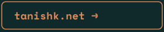
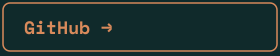

<picture>
  <source media="(max-width: 600px)" srcset="assets/boarding/hero-mobile.svg?v=petrol-final1">
  
</picture>

  <a href="https://tanishk.net"><picture><source media="(max-width: 600px)" srcset="assets/boarding/website-mobile.svg"></picture></a>
  <a href="https://www.linkedin.com/in/tanishk004"><picture><source media="(max-width: 600px)" srcset="assets/boarding/linkedin-mobile.svg"></picture></a>
  <a href="https://github.com/10ishk"><picture><source media="(max-width: 600px)" srcset="assets/boarding/github-mobile.svg"></picture></a>

<picture>
  <source media="(max-width: 600px)" srcset="assets/boarding/mission-mobile.svg?v=petrol-final1">
  
</picture>

<picture>
  <source media="(max-width: 600px)" srcset="assets/boarding/stack-mobile.svg?v=petrol-final1">
  
</picture>

<picture>
  <source media="(max-width: 600px)" srcset="assets/boarding/departures-mobile.svg?v=petrol-headings2">
  
</picture>

<a href="https://github.com/10ishk/movi-agent">
<picture>
  <source media="(max-width: 600px)" srcset="assets/boarding/movi-agent-mobile.svg?v=petrol-final1">
  
</picture>
</a>
<a href="https://github.com/10ishk/two-stage-ppe">
<picture>
  <source media="(max-width: 600px)" srcset="assets/boarding/two-stage-ppe-mobile.svg?v=petrol-final1">
  
</picture>
</a>
<a href="https://github.com/10ishk/FlickVox">
<picture>
  <source media="(max-width: 600px)" srcset="assets/boarding/FlickVox-mobile.svg?v=petrol-final1">
  
</picture>
</a>
<a href="https://github.com/10ishk/voice-lead-agent">
<picture>
  <source media="(max-width: 600px)" srcset="assets/boarding/voice-lead-agent-mobile.svg?v=petrol-final1">
  
</picture>
</a>
<a href="https://github.com/10ishk/ak680-studio">
<picture>
  <source media="(max-width: 600px)" srcset="assets/boarding/ak680-studio-mobile.svg?v=petrol-final1">
  
</picture>
</a>
<a href="https://github.com/10ishk/quick-commerce-launch-control-tower">
<picture>
  <source media="(max-width: 600px)" srcset="assets/boarding/quick-commerce-launch-control-tower-mobile.svg?v=petrol-final1">
  
</picture>
</a>
<a href="https://github.com/10ishk/b2b-customer-expansion-radar">
<picture>
  <source media="(max-width: 600px)" srcset="assets/boarding/b2b-customer-expansion-radar-mobile.svg?v=petrol-final1">
  
</picture>
</a>
<a href="https://github.com/10ishk/yardvision-sop-monitoring">
<picture>
  <source media="(max-width: 600px)" srcset="assets/boarding/yardvision-sop-monitoring-mobile.svg?v=petrol-final1">
  
</picture>
</a>
<a href="https://github.com/10ishk/it-support-operations-lab">
<picture>
  <source media="(max-width: 600px)" srcset="assets/boarding/it-support-operations-lab-mobile.svg?v=petrol-final1">
  
</picture>
</a>
<a href="https://github.com/10ishk/ak680-overlay-studio">
<picture>
  <source media="(max-width: 600px)" srcset="assets/boarding/ak680-overlay-studio-mobile.svg?v=petrol-final1">
  
</picture>
</a>
<a href="https://github.com/10ishk/cargo-visibility-control-tower">
<picture>
  <source media="(max-width: 600px)" srcset="assets/boarding/cargo-visibility-control-tower-mobile.svg?v=petrol-final1">
  
</picture>
</a>
<a href="https://github.com/10ishk/port-yard-dispatch-optimizer">
<picture>
  <source media="(max-width: 600px)" srcset="assets/boarding/port-yard-dispatch-optimizer-mobile.svg?v=petrol-final1">
  
</picture>
</a>
<a href="https://tanishk.net">
<picture>
  <source media="(max-width: 600px)" srcset="assets/boarding/tanishk-portfolio-mobile.svg?v=petrol-final1">
  
</picture>
</a>
<a href="https://github.com/10ishk/lstm-text-generator">
<picture>
  <source media="(max-width: 600px)" srcset="assets/boarding/lstm-text-generator-mobile.svg?v=petrol-final1">
  
</picture>
</a>
<a href="https://github.com/10ishk/CallSense-App">
<picture>
  <source media="(max-width: 600px)" srcset="assets/boarding/CallSense-App-mobile.svg?v=petrol-final1">
  
</picture>
</a>
<a href="https://github.com/10ishk/AdverseWeatherAVDetection">
<picture>
  <source media="(max-width: 600px)" srcset="assets/boarding/AdverseWeatherAVDetection-mobile.svg?v=petrol-final1">
  
</picture>
</a>

<picture>
  <source media="(max-width: 600px)" srcset="assets/boarding/earlier-mobile.svg?v=petrol-headings2">
  
</picture>

<a href="https://github.com/10ishk/ai_models">
<picture>
  <source media="(max-width: 600px)" srcset="assets/boarding/ai_models-mobile.svg?v=petrol-final1">
  
</picture>
</a>
<picture>
  <source media="(max-width: 600px)" srcset="assets/boarding/Face_recog-mobile.svg?v=petrol-final1">
  
</picture>
<picture>
  <source media="(max-width: 600px)" srcset="assets/boarding/Housing_analysis-mobile.svg?v=petrol-final1">
  
</picture>

<picture>
  <source media="(max-width: 600px)" srcset="assets/boarding/log-mobile.svg?v=petrol-headings2">
  
</picture>

<picture>
  <source media="(prefers-reduced-motion: reduce) and (prefers-color-scheme: dark)" srcset="https://raw.githubusercontent.com/10ishk/10ishk/output-petrol-copper/flight-log-v2-dark-still.svg">
  <source media="(prefers-reduced-motion: reduce)" srcset="https://raw.githubusercontent.com/10ishk/10ishk/output-petrol-copper/flight-log-v2-light-still.svg">
  <source media="(prefers-color-scheme: dark)" srcset="https://raw.githubusercontent.com/10ishk/10ishk/output-petrol-copper/flight-log-v2-dark.svg">
  
</picture>
