<picture>
  <source media="(max-width: 600px)" srcset="assets/boarding/hero-mobile.svg">
  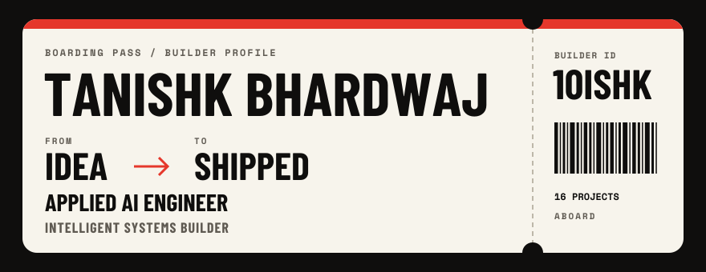
</picture>

  
  
  

I turn ideas into useful tools: computer vision for logistics and safety, local desktop apps, and practical operations systems.

<picture>
  <source media="(max-width: 600px)" srcset="assets/boarding/stack-mobile.svg">
  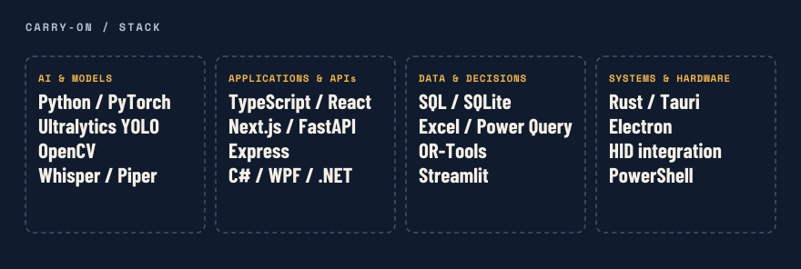
</picture>

<picture>
  <source media="(max-width: 600px)" srcset="assets/boarding/departures-mobile.svg">
  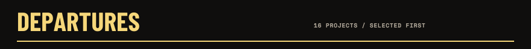
</picture>

<a href="https://github.com/10ishk/two-stage-ppe">
<picture>
  <source media="(max-width: 600px)" srcset="assets/boarding/two-stage-ppe-mobile.svg">
  
</picture>
</a>
<a href="https://github.com/10ishk/FlickVox">
<picture>
  <source media="(max-width: 600px)" srcset="assets/boarding/FlickVox-mobile.svg">
  
</picture>
</a>
<a href="https://github.com/10ishk/movi-agent">
<picture>
  <source media="(max-width: 600px)" srcset="assets/boarding/movi-agent-mobile.svg">
  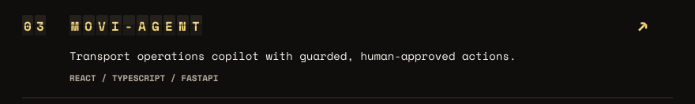
</picture>
</a>
<a href="https://github.com/10ishk/quick-commerce-launch-control-tower">
<picture>
  <source media="(max-width: 600px)" srcset="assets/boarding/quick-commerce-launch-control-tower-mobile.svg">
  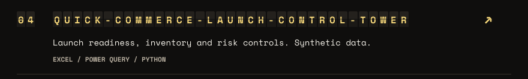
</picture>
</a>
<a href="https://github.com/10ishk/b2b-customer-expansion-radar">
<picture>
  <source media="(max-width: 600px)" srcset="assets/boarding/b2b-customer-expansion-radar-mobile.svg">
  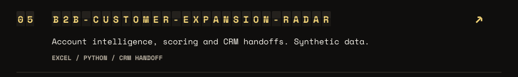
</picture>
</a>
<a href="https://github.com/10ishk/yardvision-sop-monitoring">
<picture>
  <source media="(max-width: 600px)" srcset="assets/boarding/yardvision-sop-monitoring-mobile.svg">
  
</picture>
</a>
<a href="https://github.com/10ishk/it-support-operations-lab">
<picture>
  <source media="(max-width: 600px)" srcset="assets/boarding/it-support-operations-lab-mobile.svg">
  
</picture>
</a>
<a href="https://github.com/10ishk/voice-lead-agent">
<picture>
  <source media="(max-width: 600px)" srcset="assets/boarding/voice-lead-agent-mobile.svg">
  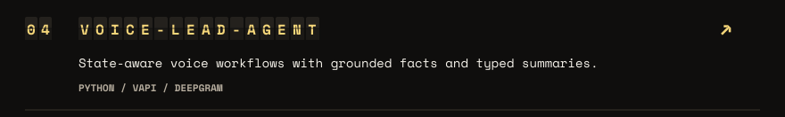
</picture>
</a>
<a href="https://github.com/10ishk/ak680-studio">
<picture>
  <source media="(max-width: 600px)" srcset="assets/boarding/ak680-studio-mobile.svg">
  
</picture>
</a>
<a href="https://github.com/10ishk/ak680-overlay-studio">
<picture>
  <source media="(max-width: 600px)" srcset="assets/boarding/ak680-overlay-studio-mobile.svg">
  
</picture>
</a>
<a href="https://github.com/10ishk/cargo-visibility-control-tower">
<picture>
  <source media="(max-width: 600px)" srcset="assets/boarding/cargo-visibility-control-tower-mobile.svg">
  
</picture>
</a>
<a href="https://github.com/10ishk/port-yard-dispatch-optimizer">
<picture>
  <source media="(max-width: 600px)" srcset="assets/boarding/port-yard-dispatch-optimizer-mobile.svg">
  
</picture>
</a>
<a href="https://github.com/10ishk/tanishk-portfolio">
<picture>
  <source media="(max-width: 600px)" srcset="assets/boarding/tanishk-portfolio-mobile.svg">
  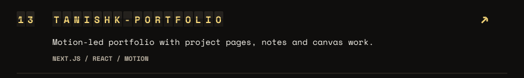
</picture>
</a>
<a href="https://github.com/10ishk/lstm-text-generator">
<picture>
  <source media="(max-width: 600px)" srcset="assets/boarding/lstm-text-generator-mobile.svg">
  
</picture>
</a>
<a href="https://github.com/10ishk/CallSense-App">
<picture>
  <source media="(max-width: 600px)" srcset="assets/boarding/CallSense-App-mobile.svg">
  
</picture>
</a>
<a href="https://github.com/10ishk/AdverseWeatherAVDetection">
<picture>
  <source media="(max-width: 600px)" srcset="assets/boarding/AdverseWeatherAVDetection-mobile.svg">
  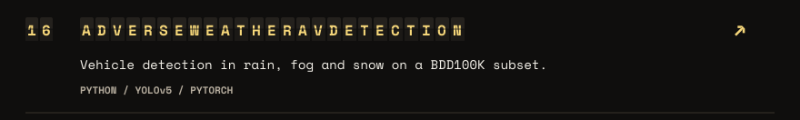
</picture>
</a>

<picture>
  <source media="(max-width: 600px)" srcset="assets/boarding/notes-mobile.svg">
  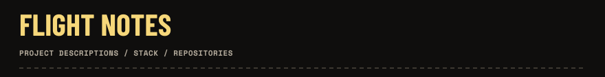
</picture>

## Project details

Open a project for the full description, stack and repository.

<strong>two-stage-ppe</strong> · <code>python · ultralytics · opencv</code>

Two-stage person-to-PPE detection with crop batching, global coordinate remapping, video inference, optional ByteTrack tracking, and dataset preparation and training tools. Bring compatible model checkpoints; none are bundled.

**Stack:** Python, Ultralytics YOLO, OpenCV, ByteTrack 
**Repo:** [10ishk/two-stage-ppe](https://github.com/10ishk/two-stage-ppe)

<strong>FlickVox</strong> · <code>c# · wpf · piper</code>

Windows text-to-speech companion with a global quick-pill hotkey, saved phrases, playback controls and voice downloads. Speech runs locally after setup; a Windows x64 preview is available in GitHub Releases.

**Stack:** C#, .NET 10, WPF, Piper, NAudio 
**Repo:** [10ishk/FlickVox](https://github.com/10ishk/FlickVox)

<strong>movi-agent</strong> · <code>react</code> <code>typescript</code> <code>fastapi</code>

Full-stack transport operations copilot: natural-language trip and route workflows with fuzzy matching, guarded vehicle actions, and human confirmation before consequential changes.

**Stack:** React, TypeScript, FastAPI, Express, SQLite 
**Repo:** [10ishk/movi-agent](https://github.com/10ishk/movi-agent)

<strong>quick-commerce-launch-control-tower</strong> · <code>excel · power-query · python</code>

Excel-first multi-site launch planning with readiness gates, inventory reconciliation, risk and issue tracking, and executive reporting. Uses synthetic UAE operations data. Includes Power BI model and report build specifications; no PBIX is included.

**Stack:** Excel, Power Query / M, Python, Power BI build specifications 
**Repo:** [10ishk/quick-commerce-launch-control-tower](https://github.com/10ishk/quick-commerce-launch-control-tower)

<strong>b2b-customer-expansion-radar</strong> · <code>excel · python · crm</code>

Customer intelligence workbook with documented business signals, transparent opportunity scoring, stakeholder gaps, account briefs and staged HubSpot handoffs. All account and business data is synthetic; the handoff package is prepared offline.

**Stack:** Excel, Python, structured CSV / JSON, HubSpot handoff assets 
**Repo:** [10ishk/b2b-customer-expansion-radar](https://github.com/10ishk/b2b-customer-expansion-radar)

<strong>yardvision-sop-monitoring</strong> · <code>python</code> <code>opencv</code> <code>yolov8</code>

Object-level logistics vision that turns camera feeds into SOP events, ROI-zone alerts, evidence snapshots, compliance review, and operational dashboards.

**Stack:** Python, OpenCV, YOLOv8, Streamlit, SQLite 
**Repo:** [10ishk/yardvision-sop-monitoring](https://github.com/10ishk/yardvision-sop-monitoring)

<strong>it-support-operations-lab</strong> · <code>powershell · windows · diagnostics</code>

Windows support toolkit for system health, networking, event logs, service investigation and SHA-256 backup/restore verification. Includes controlled execution evidence, guided incidents and local HTML reports.

**Stack:** PowerShell, Windows CIM / networking cmdlets, SHA-256, HTML / JSON / CSV 
**Repo:** [10ishk/it-support-operations-lab](https://github.com/10ishk/it-support-operations-lab)

<strong>voice-lead-agent</strong> · <code>python</code> <code>vapi</code> <code>deepgram</code>

Permission-first multilingual voice qualification with grounded project facts, state-aware conversations, explainable outcomes, and typed post-call summaries.

**Stack:** Python, YAML, Pydantic, Vapi, Deepgram 
**Repo:** [10ishk/voice-lead-agent](https://github.com/10ishk/voice-lead-agent)

<strong>ak680-studio</strong> · <code>tauri</code> <code>rust</code> <code>hid</code>

Native AK680 V2 profile inspector and configurator with local profile workflows, HID device detection, lighting controls, and mapped Rapid Trigger writes.

**Stack:** Tauri, React, TypeScript, Rust, HID 
**Repo:** [10ishk/ak680-studio](https://github.com/10ishk/ak680-studio)

<strong>ak680-overlay-studio</strong> · <code>electron</code> <code>react</code> <code>typescript</code>

Electron overlay controller for the official AJAZZ web driver, with route and DOM adapters for lighting, performance, keymap, SOCD, macros, and settings workflows.

**Stack:** Electron, React, TypeScript, Vite 
**Repo:** [10ishk/ak680-overlay-studio](https://github.com/10ishk/ak680-overlay-studio)

<strong>cargo-visibility-control-tower</strong> · <code>python</code> <code>sqlite</code> <code>power-bi</code>

Shipment control tower for visibility, SLA breaches, exceptions, hub performance, and revenue-at-risk analysis, backed by a documented local BI workflow.

**Stack:** Python, SQLite, SQL, Power BI, Streamlit, Plotly 
**Repo:** [10ishk/cargo-visibility-control-tower](https://github.com/10ishk/cargo-visibility-control-tower)

<strong>port-yard-dispatch-optimizer</strong> · <code>python</code> <code>ortools</code> <code>fastapi</code>

Dispatch planning prototype with capacity checks, delivery windows, route cost, priority handling, SLA-risk scoring, and an OR-Tools solver with a deterministic fallback.

**Stack:** Python, OR-Tools, FastAPI, Streamlit, SQLite, Plotly 
**Repo:** [10ishk/port-yard-dispatch-optimizer](https://github.com/10ishk/port-yard-dispatch-optimizer)

<strong>tanishk-portfolio</strong> · <code>next.js</code> <code>react</code> <code>motion</code>

Motion-led editorial portfolio with project pages, notes, experience views, interactive canvas surfaces, and multiple home-page prototypes.

**Stack:** Next.js, React, TypeScript, Motion, GSAP, Playwright 
**Repo:** [10ishk/tanishk-portfolio](https://github.com/10ishk/tanishk-portfolio)

<strong>lstm-text-generator</strong> · <code>pytorch</code> <code>lstm</code> <code>nlp</code>

Reproducible word-level text generation pipeline covering data preparation, vocabulary handling, LSTM training, validation, and temperature-based sampling.

**Stack:** Python, PyTorch, LSTM, Jupyter, pytest 
**Repo:** [10ishk/lstm-text-generator](https://github.com/10ishk/lstm-text-generator)

<strong>CallSense-App</strong> · <code>python</code> <code>whisper</code> <code>nlp</code>

Call intelligence pipeline that transcribes audio, summarizes conversations, classifies emotion, estimates urgency, extracts actions, and exports structured reports.

**Stack:** Python, Whisper, Transformers, Streamlit, CSV, JSON 
**Repo:** [10ishk/CallSense-App](https://github.com/10ishk/CallSense-App)

<strong>AdverseWeatherAVDetection</strong> · <code>python</code> <code>yolov5</code> <code>computer-vision</code>

Vehicle detection under rain, fog, and snow using an adverse-weather BDD100K subset, YOLO annotation conversion, transfer learning, and recorded evaluation metrics.

**Stack:** Python, YOLOv5, PyTorch, BDD100K, Jupyter 
**Repo:** [10ishk/AdverseWeatherAVDetection](https://github.com/10ishk/AdverseWeatherAVDetection)

<strong>archive</strong> · <em>older work</em>

- [ai_models](https://github.com/10ishk/ai_models) — classic ML notebooks covering regression, clustering, KNN, SVM, and decision trees
- [Face_recog](https://github.com/10ishk/Face_recog) — early computer-vision experimentation
- [Housing_analysis](https://github.com/10ishk/Housing_analysis) — exploratory data analysis and regression work

<picture>
  <source media="(max-width: 600px)" srcset="assets/boarding/log-mobile.svg">
  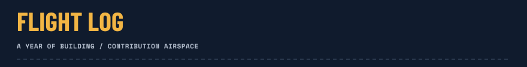
</picture>

<picture>
  <source media="(prefers-color-scheme: dark)" srcset="https://raw.githubusercontent.com/10ishk/10ishk/output-boarding/snake-dark.svg">
  <source media="(prefers-color-scheme: light)" srcset="https://raw.githubusercontent.com/10ishk/10ishk/output-boarding/snake.svg">
  
</picture>

<a href="https://tanishk.net">tanishk.net</a> · <a href="https://www.linkedin.com/in/tanishk004">LinkedIn</a> · <a href="https://github.com/10ishk">GitHub</a>

